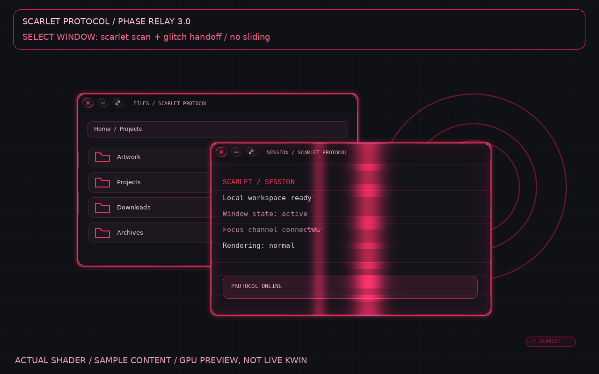

# Scarlet Protocol

A coordinated cyberpunk desktop for **KDE Plasma 6**: dark surfaces, rounded Classic Slits window frames, scarlet illumination, custom icons and cursors, desktop tools, synthesized sounds, and matching window effects. Includes the companion Chrome theme and new-tab dashboard.



## Download and install

**[Download the complete suite from Releases](https://github.com/Jgustafsonxjr1990/Scarlet-Protocol/releases/latest).** Extract the ZIP fully before launching an installer.

| Component | Start here |
| --- | --- |
| Complete Plasma theme and desktop tools | `plasma/Scarlet-Desktop-Studio` in the release ZIP |
| Cyber Circuit / Night Shift / Overdrive sounds | `sounds/Scarlet-Sound-Studio` in the release ZIP |
| Glitch Drag — Wobbly Windows replacement | `effects/glitch-drag/Install-Glitch-Drag` |
| Phase Relay — Slide Back replacement | `effects/phase-relay/Install-Phase-Relay` |
| Open/close, minimize/restore, maximize/restore animations | See [window motion instructions](plasma/motion-suite/README.md) |
| Pointer click and trail effects, including a paw-print style | See [pointer build/install instructions](effects/pointer/README.md) |
| Chrome theme, animated new tab and optional web edges | See [Chrome instructions](chrome/INSTALL.txt) |

Run desktop installers as your **normal user**, without sudo. If your extractor removes executable permissions, enable **Is executable** in the file's Properties → Permissions. Portable desktop/sound apps target Linux x86-64. Pointer effects are native plugins and must be built against the KWin version installed on your computer.

### Install from source

```bash
git clone https://github.com/Jgustafsonxjr1990/Scarlet-Protocol.git
cd Scarlet-Protocol
bash install.sh theme
```

This installs the visual components. Then select **Scarlet Protocol — Blackout** or **Night Shift** in System Settings → Colors & Themes → Global Theme. Existing installations use `python3 plasma/upgrade.py --apply`, which backs up changed components. Desktop Studio in the release ZIP provides the graphical apply/restore workflow.

Other components are separate choices:

```bash
bash install.sh sounds   # install/apply Cyber Circuit sounds
bash install.sh drag     # load Glitch Drag, replace Wobbly Windows
bash install.sh focus    # load Phase Relay, replace Slide Back
bash install.sh pointer  # build native click/trail plugin; sudo only at final install
```

There is no automatic all-components switch: native plugin builds, browser extensions, appearance selection and desktop effects have different installation requirements. You can install the pieces you want.

## Included

- **Plasma 8.1 Classic Slits:** rounded illuminated outlines, fine perpendicular segmented cuts, Blackout and Night Shift editions, functional red/yellow/green hover controls.
- **Desktop Studio:** appearance installation, verification, restoration, window customization and icon tools. Optional launcher, clock, System Core widget, orbit wallpaper and Window Deck switcher.
- **Icons and cursors:** thousands of app, action, folder, device and status vectors, plus themed cursor artwork; original component notices are preserved.
- **Glitch Drag 3.0:** continuous red scanning columns, torn image strips and scarlet echoes throughout a window drag. Release restores the native image.
- **Phase Relay 3.0:** an existing window comes forward with a short scarlet scan-and-glitch handoff. KWin owns the real stacking order; no sliding, flipping or temporary elevation.
- **Motion suite:** opening/closing Pulse, Recall minimize/restore, Overdrive maximize/restore.
- **Pointer effects:** configurable click artwork and trails, with a paw-print option.
- **Cyber Circuit 2 sounds:** 39 original synthesized cues in three editions, standard event aliases, WAV masters, Ogg themes, preview browser and Sound Studio.
- **Chrome companion:** color theme, animated new-tab dashboard, customization and optional page-edge treatment. Chrome controls which native browser surfaces extensions can style; page animations do not imply every native tab animates.

## Compatibility and validation

The reference desktop uses **KWin 6.7.4**. Plasma/KWin APIs and native plugin ABI can differ between releases; no universal Plasma 6 compatibility is claimed. Python scripts require Python 3. Scripted effects need `kpackagetool6`, `kwriteconfig6`, and `gdbus` or `qdbus6`. Rebuilding portable GUIs uses the versions documented in their component notices. Qt/PySide and build dependencies are not needed to run the prebuilt Studio apps.

Glitch Drag was positively tested by the project owner on the reference desktop. Phase Relay has local script-engine, shader and installer checks; broader compositor playback, HDR, multi-monitor behavior and cross-distribution testing remain open. Component READMEs distinguish rendered previews, isolated tests and on-device verification.

Sound installation selects a freedesktop/KDE sound theme; applications must emit the corresponding sound events. It does not introduce system-wide click or window audio hooks.

**[Report an issue](https://github.com/Jgustafsonxjr1990/Scarlet-Protocol/issues)** with your Plasma/KWin version, X11 or Wayland session, affected component, steps to reproduce and relevant installer error. Avoid including credentials or unrelated personal logs.

## Source, licenses and rebuilding

Editable application code, artwork, shaders, synthesis code and build scripts are included. Large prebuilt Studio binaries are supplied as release assets rather than stored in Git. See [component map and build notes](docs/COMPONENTS.md).

Component licenses and third-party notices remain authoritative. The repository preserves the original GPL/MIT component licenses, modified KDE Breeze icon notices under LGPL-3.0-or-later, font licenses, and Python/Qt/PySide/PyInstaller runtime terms. Consult the `LICENSE`, `LICENSES` and component notice files before redistribution; the root license does not replace third-party terms.

Created for Jon's Scarlet Protocol desktop and shared for others to install, customize and improve.
